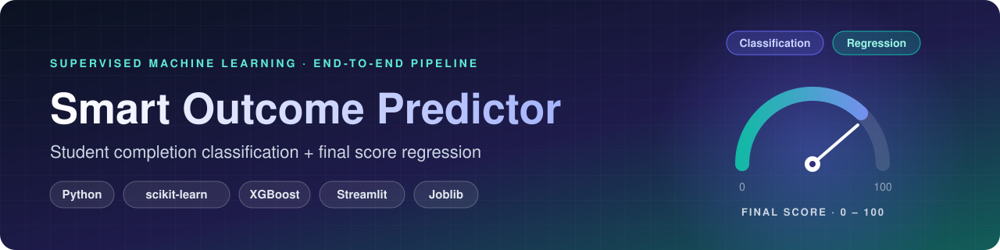
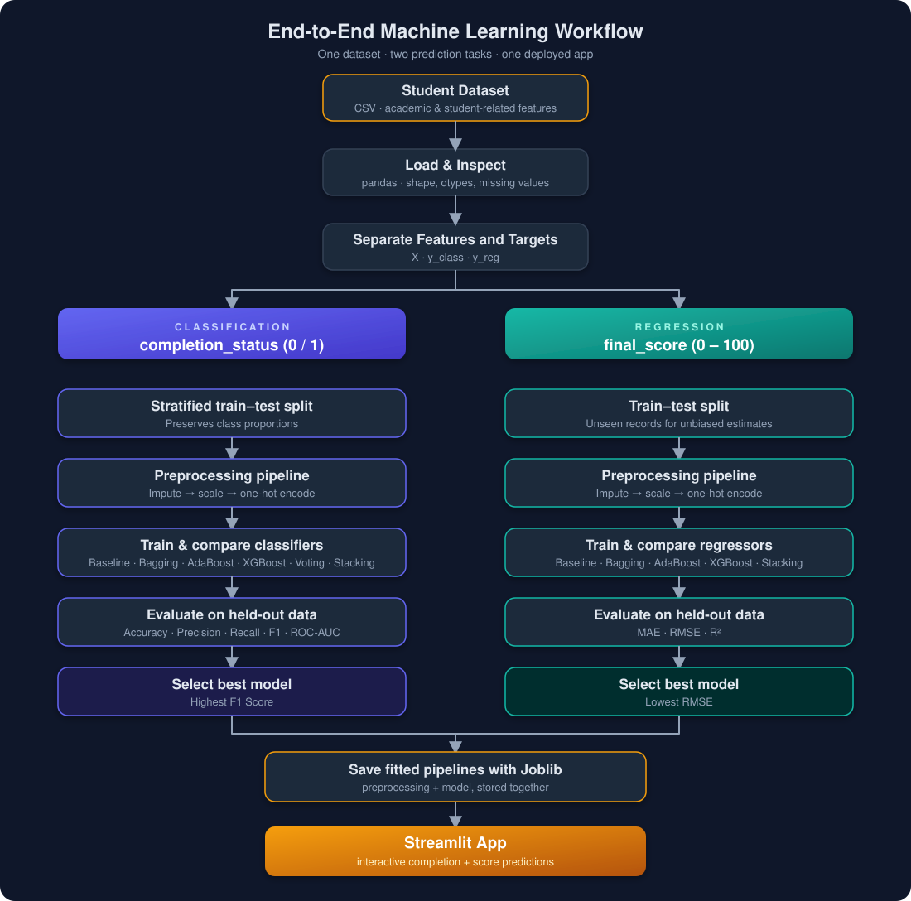
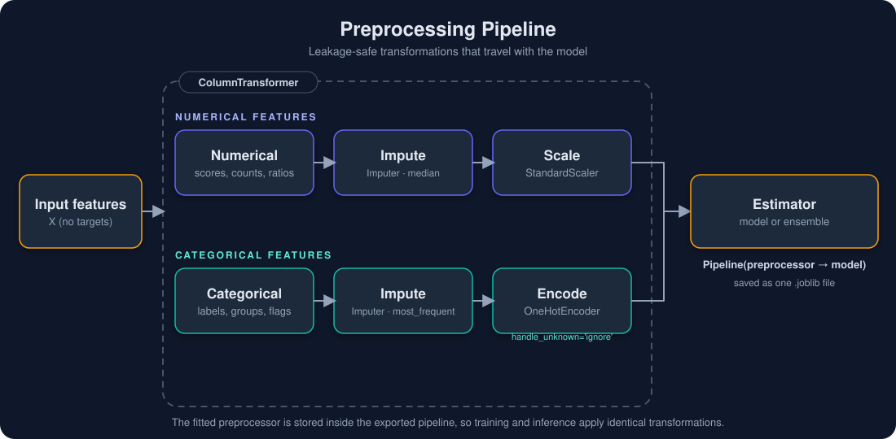
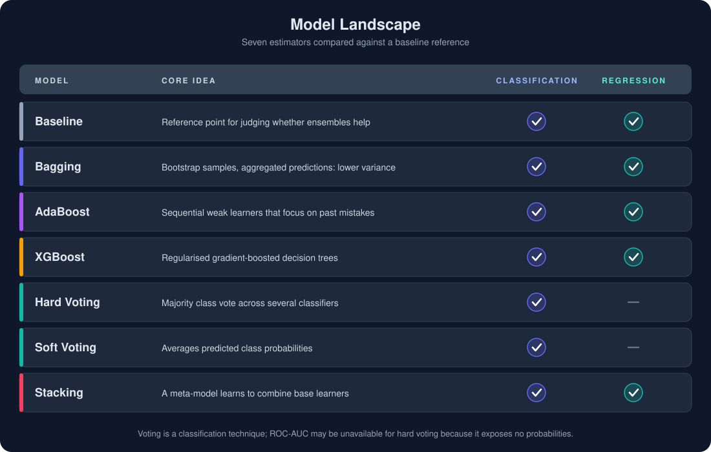
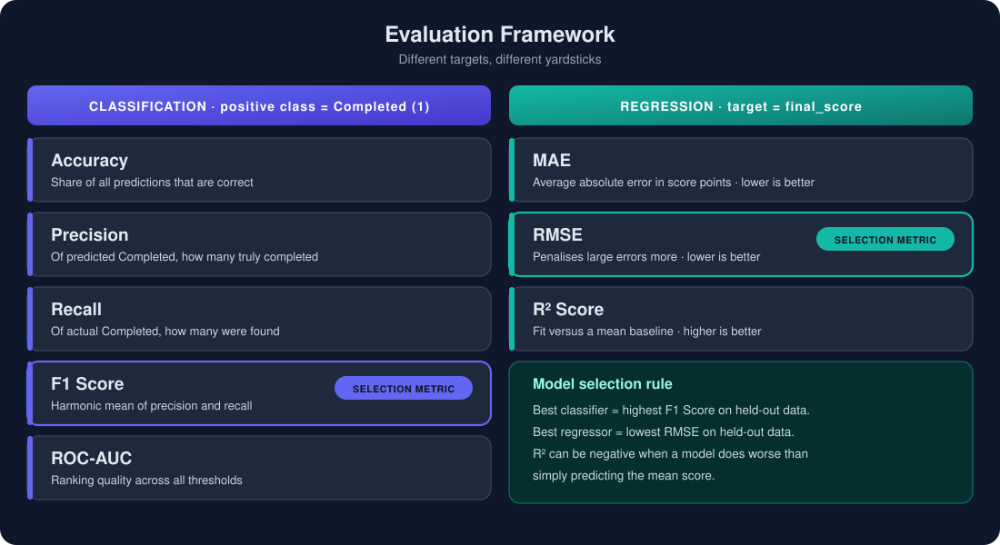
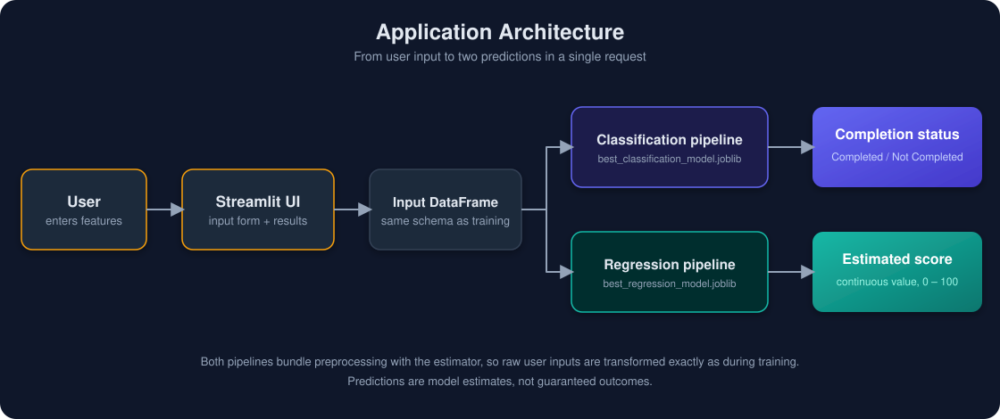

<div align="center">



<br/>

### Predict whether a student will **complete** the program, and estimate the **final score**, from a single set of inputs.

<br/>

[](https://message-intelligence-system-caoshnbr62mgxmuwxbsemm.streamlit.app/)
[](https://message-intelligence-system-caoshnbr62mgxmuwxbsemm.streamlit.app/)


**[Live Demo](#-live-demo)** &nbsp;·&nbsp; **[Workflow](#-machine-learning-workflow)** &nbsp;·&nbsp; **[Models](#-models-compared)** &nbsp;·&nbsp; **[Results](#-results-and-visualizations)** &nbsp;·&nbsp; **[Quick Start](#-quick-start)** &nbsp;·&nbsp; **[Troubleshooting](#-troubleshooting)**

</div>

---

## Table of Contents

1. [Live Demo](#-live-demo)
2. [Overview](#-overview)
3. [Key Features](#-key-features)
4. [Problem Formulation](#-problem-formulation)
5. [Machine Learning Workflow](#-machine-learning-workflow)
6. [Data Preprocessing](#-data-preprocessing)
7. [Models Compared](#-models-compared)
8. [Evaluation Framework](#-evaluation-framework)
9. [Results and Visualizations](#-results-and-visualizations)
10. [Application Architecture](#-application-architecture)
11. [Project Structure](#-project-structure)
12. [Quick Start](#-quick-start)
13. [Training and Exporting Models](#-training-and-exporting-models)
14. [Generating the Visualizations](#-generating-the-visualizations)
15. [Running the Streamlit App](#-running-the-streamlit-app)
16. [Troubleshooting](#-troubleshooting)
17. [Limitations](#-limitations)
18. [Responsible Use](#-responsible-use)
19. [Roadmap](#-roadmap)
20. [Author](#-author)

---

## 🚀 Live Demo

<div align="center">

### 👉 **[Launch the Streamlit App]([https://message-intelligence-system-caoshnbr62mgxmuwxbsemm.streamlit.app/](https://smart-outcome-predictor-hidmcg5sqek7vov3gcdrsc.streamlit.app/))** 👈

`https://message-intelligence-system-caoshnbr62mgxmuwxbsemm.streamlit.app/`

</div>

**What you can do in the app**

| Step | Action |
|:---:|---|
| **1** | Open the live app in your browser. |
| **2** | Enter the requested student feature values. |
| **3** | Submit the form to run both trained pipelines. |
| **4** | Read the **predicted completion status** and the **estimated final score (0 - 100)**. |

> ⚠️ Predictions are estimates learned from patterns in the training data. They are **not** guaranteed outcomes and must not be the sole basis for decisions about students. See [Responsible Use](#-responsible-use).

---

## 📌 Overview

**Smart Outcome Predictor** is an end-to-end supervised machine learning project that answers two different questions about a student, using academic and other student-related data:

| | Task | Target | Output |
|:---:|---|---|---|
| 🟣 | **Classification** | `completion_status` | Will the student complete the program? (`0` = Not Completed, `1` = Completed) |
| 🟢 | **Regression** | `final_score` | What final score is the student likely to reach? (continuous, 0 - 100) |

The project compares several algorithms, including bagging, boosting, voting and stacking ensembles, behind a shared preprocessing pipeline. It evaluates each with task-appropriate metrics, selects the best model per task, serialises the complete fitted pipelines with Joblib, and serves them through an interactive Streamlit application.

At a glance:

| | |
|---|---|
| **Project type** | Supervised machine learning (classification + regression) |
| **Language** | Python |
| **Core libraries** | pandas, NumPy, scikit-learn, XGBoost, Matplotlib, Joblib |
| **Deployment** | Streamlit web application |
| **Selection rule** | Best classifier by **F1 Score** · best regressor by **lowest RMSE** |

---

## ✨ Key Features

- 🔀 **Two tasks, one dataset:** classification and regression trained and evaluated side by side.
- 🧹 **Robust preprocessing:** median/most-frequent imputation, standard scaling and one-hot encoding inside a `ColumnTransformer`.
- 🤖 **Broad model comparison:** baseline, Bagging, AdaBoost, XGBoost, hard and soft Voting, and Stacking.
- 📏 **Honest evaluation:** Accuracy, Precision, Recall, F1 and ROC-AUC for classification; MAE, RMSE and R² for regression.
- 🏆 **Metric-driven selection:** the best model is chosen by a pre-declared metric, not by eye.
- 📦 **Production-style export:** the fitted preprocessing and estimator are saved together, so inference matches training exactly.
- 🖥️ **Interactive app:** a Streamlit interface that returns both predictions at once.
- 📊 **Reproducible visuals:** one script regenerates every chart in this README from your real results.

---

## 🎯 Problem Formulation

### Classification: `completion_status`

| Target value | Meaning |
|:---:|---|
| `0` | Not Completed |
| `1` | Completed (**positive class**) |

### Regression: `final_score`

A continuous target from **0 to 100**. Instead of choosing a class, the model estimates a number.

### Input features

All columns in the dataset **except** `completion_status` and `final_score`. The exact feature names depend on the dataset supplied; the same schema must be used for training and inference.

```python
X       = df.drop(columns=["completion_status", "final_score"])
y_class = df["completion_status"]
y_reg   = df["final_score"]
```

---

## 🧭 Machine Learning Workflow

<div align="center">
  
</div>

| Stage | What happens |
|---|---|
| **1. Load and inspect** | Read the CSV with pandas; check shape, dtypes, missing values. |
| **2. Separate** | Split features `X` from the two targets. |
| **3. Train-test split** | Hold out unseen records. Classification uses a **stratified** split to preserve class proportions. |
| **4. Preprocess** | Apply the `ColumnTransformer` pipeline (see below). |
| **5. Train** | Fit every candidate model on the training set. |
| **6. Evaluate** | Score on the held-out test set with task-specific metrics. |
| **7. Export** | Save the best fitted pipelines with Joblib. |
| **8. Deploy** | Load the pipelines in Streamlit and serve predictions. |

---

## 🧹 Data Preprocessing

<div align="center">
  
</div>

| Feature type | Missing values | Transformation |
|---|---|---|
| **Numerical** | Imputed with the **median** | Standardised with `StandardScaler` |
| **Categorical** | Imputed with the **most frequent** value | Encoded with `OneHotEncoder(handle_unknown="ignore")` |

`handle_unknown="ignore"` lets the app accept categories it never saw during training without crashing. Because preprocessing lives **inside** the pipeline, the exact same transformations are applied at training time and at prediction time, which prevents train/serve mismatch.

---

## 🤖 Models Compared

<div align="center">
  
</div>

<details>
<summary><b>📖 How each algorithm works</b> (click to expand)</summary>

<br/>

| Algorithm | Idea | Why it is included |
|---|---|---|
| **Baseline** | A simple reference estimator. | Shows whether more complex models actually add value. |
| **Bagging** | Trains many estimators on bootstrap samples and aggregates their predictions. | Reduces variance and improves stability. |
| **AdaBoost** | Builds weak learners in sequence, with later learners focusing on earlier mistakes. | Turns weak learners into a stronger combined model. |
| **XGBoost** | Gradient-boosted decision trees with built-in regularisation. | Strong, widely used tabular-data learner. |
| **Hard Voting** | Each classifier votes; the majority class wins. | Simple, transparent ensemble. |
| **Soft Voting** | Averages predicted class probabilities and picks the highest. | Uses confidence, not just votes. Requires probability-capable estimators. |
| **Stacking** | A meta-model learns how to best combine the base models' outputs. | Can capture complementary strengths of different learners. |

The exact base estimators and hyperparameters are defined in the training notebook.

</details>

---

## 📏 Evaluation Framework

<div align="center">
  
</div>

**Why two metric sets?** A class label and a number are different kinds of output, so they need different yardsticks.

- **F1 Score** selects the best classifier because it balances Precision and Recall, which matters when both false positives and false negatives carry a cost.
- **RMSE** selects the best regressor; it penalises large errors more heavily than MAE.
- **ROC-AUC** is only available when a model exposes probabilities or scores. A hard-voting classifier may not, in which case its ROC-AUC is reported as `N/A`.
- **R²** can be negative when a model performs worse than simply predicting the mean score.

---

## 📊 Results and Visualizations

> All figures below are produced by [`generate_visuals.py`](generate_visuals.py) from the real dataset, results tables and exported models. Run it once (see [Generating the Visualizations](#-generating-the-visualizations)) and commit `assets/figures/` so the images render here.

### Dataset overview

<div align="center">
  
</div>

### Classification

<div align="center">
  
</div>

<table>
  <tr>
    <td align="center" width="55%">
      
    </td>
    <td align="center" width="45%">
      
    </td>
  </tr>
</table>

### Regression

<div align="center">
  
</div>

<div align="center">
  
</div>

### What drives the predictions

<div align="center">
  
</div>

### Results tables

Running the visual script also writes `results/results_tables.md` with both tables, best model in **bold** and unavailable metrics shown as `N/A`. Paste them here:

<!-- RESULTS-TABLES-START -->

_Paste the contents of `results/results_tables.md` here after running `generate_visuals.py`._

<!-- RESULTS-TABLES-END -->

### Final result summary

| Result | Value |
|---|---|
| Best classification model | _fill from `results_tables.md`_ |
| Best classification F1 Score | _fill_ |
| Best classification Accuracy | _fill_ |
| Best classification ROC-AUC | _fill, if available_ |
| Best regression model | _fill_ |
| Best regression RMSE | _fill_ |
| Best regression MAE | _fill_ |
| Best regression R² | _fill_ |

**How to read the results**

- Does the best classifier keep Precision and Recall reasonably balanced?
- Is the best regressor's error acceptable in **score points** (MAE and RMSE share the target's units)?
- Do the ensembles beat the baseline by a margin that is practically meaningful?

Do not conclude that any model is universally superior from a single test split. Results can change with the dataset, the split, model settings and the class distribution.

---

## 🖥️ Application Architecture

<div align="center">
  
</div>

The app loads two serialised pipelines. Each bundles its own preprocessing, so raw user input is transformed exactly as it was during training before reaching the estimator.

---

## 🗂️ Project Structure

```text
Smart-Outcome-Predictor/
│
├── app.py                              # Streamlit interface and prediction logic
├── generate_visuals.py                 # Rebuilds every figure from real results
├── requirements.txt                    # Python dependencies
├── README.md                           # This file
├── .gitignore
│
├── assets/
│   ├── banner.svg                      # README header banner
│   ├── workflow.svg                    # End-to-end ML workflow diagram
│   ├── preprocessing-pipeline.svg      # ColumnTransformer diagram
│   ├── model-landscape.svg             # Models x tasks matrix
│   ├── evaluation-framework.svg        # Metrics and selection rules
│   ├── app-architecture.svg            # Streamlit app data flow
│   └── figures/                        # Generated charts (PNG)
│       ├── data_overview.png
│       ├── classification_comparison.png
│       ├── regression_comparison.png
│       ├── confusion_matrix.png
│       ├── roc_curve.png
│       ├── regression_diagnostics.png
│       └── feature_importance.png
│
├── data/
│   └── student_data.csv                # Training dataset
│
├── models/
│   ├── best_classification_model.joblib
│   ├── best_regression_model.joblib
│   └── model_metadata.json
│
├── notebooks/
│   └── Smart_Outcome_Predictor.ipynb   # Training, comparison and evaluation
│
└── results/
    ├── classification_results.csv
    ├── regression_results.csv
    └── results_tables.md               # Auto-generated README tables
```

| Path | Purpose |
|---|---|
| `app.py` | Streamlit UI that loads the pipelines and returns predictions |
| `generate_visuals.py` | Creates all charts and README-ready result tables |
| `assets/` | README banner, diagrams and generated figures |
| `data/` | Input dataset used for training |
| `models/` | Exported fitted pipelines and metadata |
| `notebooks/` | Model development and evaluation |
| `results/` | Evaluation tables |

> The `.joblib` files only exist after training and export. A fresh clone will not have them unless they are committed or downloaded separately.

---

## ⚡ Quick Start

### Prerequisites

- Python **3.12** (or a version compatible with your saved models)
- `pip`
- Git
- Jupyter Notebook or JupyterLab, for training

### 1. Clone

```bash
git clone <YOUR_GITHUB_REPOSITORY_URL>
cd Smart-Outcome-Predictor
```

### 2. Create a virtual environment

**Windows (PowerShell)**

```powershell
py -3.12 -m venv .venv
.\.venv\Scripts\Activate.ps1
```

**macOS / Linux**

```bash
python3 -m venv .venv
source .venv/bin/activate
```

### 3. Install dependencies

```bash
python -m pip install --upgrade pip
python -m pip install -r requirements.txt
python -c "import xgboost; print(xgboost.__version__)"   # verify
```

A starting `requirements.txt`:

```text
streamlit
pandas
numpy
scikit-learn
joblib
xgboost
matplotlib
seaborn
```

> For reproducible deployment, pin the exact versions from the environment used to train and export the models. Saved models are not guaranteed to load across different scikit-learn versions.

### 4. Verify required files

```text
app.py
requirements.txt
models/best_classification_model.joblib
models/best_regression_model.joblib
```

---

## 🧪 Training and Exporting Models

Training happens in the notebook. The app only loads the exported pipelines and never retrains.

```bash
python -m pip install jupyter
jupyter notebook
```

Run the notebook cells in order (preprocessing, split, training, evaluation). Then execute this cell **in the same kernel** to export the winners:

```python
import os, json, joblib

os.makedirs("models", exist_ok=True)

# Best classifier by F1 Score, best regressor by RMSE
best_clf_name = classification_results.sort_values("F1 Score", ascending=False).iloc[0]["Model"]
best_reg_name = regression_results.sort_values("RMSE", ascending=True).iloc[0]["Model"]

best_clf = classification_models[best_clf_name]
best_reg = regression_models[best_reg_name]

# Save the complete fitted pipelines (preprocessing + estimator)
joblib.dump(best_clf, "models/best_classification_model.joblib")
joblib.dump(best_reg, "models/best_regression_model.joblib")

# Save the real evaluation results
metadata = {
    "classification_model": best_clf_name,
    "classification_f1_score": float(
        classification_results.loc[classification_results["Model"] == best_clf_name, "F1 Score"].iloc[0]
    ),
    "regression_model": best_reg_name,
    "regression_rmse": float(
        regression_results.loc[regression_results["Model"] == best_reg_name, "RMSE"].iloc[0]
    ),
}
with open("models/model_metadata.json", "w") as f:
    json.dump(metadata, f, indent=4)

# Export the results tables used by generate_visuals.py
os.makedirs("results", exist_ok=True)
classification_results.to_csv("results/classification_results.csv", index=False)
regression_results.to_csv("results/regression_results.csv", index=False)

print("Exported:", best_clf_name, "|", best_reg_name)
```

> This cell assumes dictionaries named `classification_models` and `regression_models` whose keys match the `Model` column of each results table. Rename variables if your notebook differs.

---

## 🎨 Generating the Visualizations

Once the models and both results CSVs exist, run from the project root:

```bash
python generate_visuals.py
```

This creates the PNG charts in `assets/figures/` and the tables in `results/results_tables.md`.

> **Important:** `TEST_SIZE` and `RANDOM_STATE` at the top of `generate_visuals.py` must match your notebook's train-test split. Otherwise the confusion matrix, ROC curve, diagnostics and feature importance would be computed on different test rows than your reported metrics.

| Figure | Shows |
|---|---|
| `data_overview.png` | Class balance, score distribution, missing values |
| `classification_comparison.png` | All classification metrics per model |
| `regression_comparison.png` | MAE, RMSE and R² per model, best highlighted |
| `confusion_matrix.png` | Counts and per-class rates for the best classifier |
| `roc_curve.png` | Ranking quality (skipped if the model exposes no scores) |
| `regression_diagnostics.png` | Actual vs predicted, residual distribution, residuals vs predicted |
| `feature_importance.png` | Permutation importance for both best models |

---

## ▶️ Running the Streamlit App

```bash
python -m streamlit run app.py
```

Streamlit prints a local address, normally **http://localhost:8501**.

1. Open the Smart Outcome Predictor page.
2. Enter the requested student feature values.
3. Submit the form.
4. Review the predicted completion status and the estimated final score.
5. Treat both as model estimates, not guarantees.

Inputs must match the original training feature columns. Never include `completion_status` or `final_score` as inputs.

Prefer not to install anything? Use the **[hosted live app](https://message-intelligence-system-caoshnbr62mgxmuwxbsemm.streamlit.app/)**.

---

## 🛠️ Troubleshooting

<details>
<summary><b><code>ModuleNotFoundError: No module named 'xgboost'</code></b></summary>

<br/>

The saved pipeline depends on XGBoost, but the environment loading it does not have the package.

```powershell
python -m pip install xgboost
python -c "import xgboost; print(xgboost.__version__)"
python -m streamlit run app.py
```

Install it in the **same environment** that launches Streamlit. On some Windows systems a compatible Microsoft Visual C++ Redistributable is also required.

</details>

<details>
<summary><b><code>FileNotFoundError</code> for a model file</b></summary>

<br/>

- Confirm the `models/` folder and exact filenames exist.
- Run the notebook's export cell.
- Launch Streamlit from the project root.
- Check the paths used in `app.py`.

</details>

<details>
<summary><b>Scikit-learn or Joblib model-loading errors</b></summary>

<br/>

Serialised models depend on library versions. Check the versions used for training, install compatible ones, or retrain and re-export the models if the original environment cannot be reproduced.

</details>

<details>
<summary><b><code>ModuleNotFoundError: No module named 'streamlit'</code></b></summary>

<br/>

```bash
python -m pip install streamlit
python -m streamlit run app.py
```

</details>

<details>
<summary><b>Prediction fails: feature names or columns do not match</b></summary>

<br/>

The app's input schema differs from the training schema. Use the original feature columns and compatible data types, never add the target columns, keep the preprocessor inside the saved pipeline, and update the app's form if the training features changed.

</details>

<details>
<summary><b>Blank Streamlit page or syntax errors</b></summary>

<br/>

- Read the full traceback in the terminal.
- Make sure `import streamlit as st` comes before any `st.*` call.
- Fix indentation and syntax errors, then restart the server.
- Run `python -m streamlit run app.py` from the correct directory.

</details>

<details>
<summary><b>Figures missing or blank in the README</b></summary>

<br/>

Run `python generate_visuals.py` and commit `assets/figures/`. The PNG files are generated, so they do not exist until the script has run.

</details>

---

## ⚠️ Limitations

- Prediction quality depends on dataset size, quality, representativeness and feature availability.
- Models can learn biases present in the training data.
- Held-out performance does not guarantee the same performance on future students.
- A predicted completion status does not explain **why** a student may or may not complete.
- Predicted scores can differ from actual final scores.
- Accuracy alone can mislead when classes are imbalanced.
- The selected model depends on the selection metric; the highest F1 does not imply the best Precision, Recall or ROC-AUC.
- Saved models can be sensitive to Python and library version changes.
- The app must not be the sole basis for high-impact educational decisions.

---

## 🛡️ Responsible Use

This project is for **educational, analytical and demonstration purposes**.

Predictions about people can cause harm if misread. Review results alongside relevant context and human judgement, and avoid treating a score or label as a verdict on someone's ability or future. Protect student privacy: do not publish identifiable or confidential records in a public repository. Before any real-world use, assess data permissions, fairness, privacy, reliability and institutional requirements.

---

## 🗺️ Roadmap

- [ ] Systematic hyperparameter tuning
- [ ] Cross-validation to measure model stability
- [ ] Class-imbalance analysis and handling where justified
- [ ] Probability calibration and model-confidence display in the app
- [ ] Model explanation (for example SHAP) alongside permutation importance
- [ ] Validation on a separate, representative dataset
- [ ] Input validation and clearer error messages in the UI
- [ ] Model versioning and training metadata tracking
- [ ] Automated tests for preprocessing, model loading and predictions

---

## 👤 Author

<div align="center">

**Roshan Marathe**

[](https://github.com/roshanmarathe)
[](https://www.linkedin.com/in/roshan-marathe-960748358/)

**Project repository:** _add the repository URL here once published._

<br/>

⭐ If this project helped you, consider giving the repository a star.

</div>

---

<div align="center">
  <sub>Update feature names, package versions and numeric results to match your final version before publishing.</sub>
</div>
